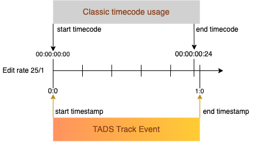

# 0003: Using TADS with media files

While [AppNote 0001](./0001-using-tads-with-tams.md) describes the use of TADS alongside TAMS, the TADS API is designed for general use outside the scope of TAMS.
One such use case is storing data that annotates media held in files.

## Basic use

This section provides guidance on how TADS can be used in a straightforward way with media files.
This approach might not be suitable for sophisticated workflows or complex production pipelines — see [Considerations and advanced use](#considerations-and-advanced-use) below.

### Track `timeline_reference`

The primary mechanism for associating TADS data with media content is through the `timeline_reference.entity_id` property required on each Track.
In a straightforward scenario:

* `timeline_reference.entity_id` points directly to a specific media file.
  * For example, this could be a URL for where the file is stored.
* `timeline_reference.timeline_selected` is set to `urn:x-tads:timeline:playback` ,as per [AppNote0002](./0002-populating-the-timeline-selected-property.md), to signal that Track Event timings use the media file playback timeline (`0.0` seconds is at the beginning of media file playback).

### Track `edit_rate`

When working with media files, and especially when converting to and from count-based time, it is common for annotation timings to conform to a grid defined by media units.
As such:

* Track `edit_rate` is set to match the contents of the media file.
  * For example, this could be based on video frame rate or audio sample rate, depending on the workflow.

### Track Event `timerange`

TADS uses [TimeRanges](https://bbc.github.io/tads/0.1/index.html#/schemas/timerange) with nanosecond resolution Timestamps.
This is the same time representation model used in TAMS.
For Track Events that relate to a media file:

* An instantaneous Track Event (one with a duration of zero) has a `timerange` of the form `[<Timestamp>]`.
* A Track Event with a non-zero duration has a `timerange` of the form `[<start Timestamp>_<end Timestamp>)`.
  * Pay attention to when the Track Event ends: use `<end Timestamp>` to signal the instant at which the Track Event ends.
* Every Timestamp conforms to the Track `edit_rate`.
  * Note that for a given `edit_rate`, for each media unit count there is a single valid Timestamp string.
  * Refer to [TAMS AppNote 0008](https://github.com/bbc/tams/blob/main/docs/appnotes/0008-timestamps-in-TAMS.md#timestamp-representation) for more practical guidance.

Some count-based time representations adopt other conventions.

* For example, when using timecode, the end value of a range often identifies the start of the final frame of the event.

Example: An event begins at `0.0` seconds and ends at `1.0` seconds.

* The timecode representation at 25 frames per second has the event start with the frame `00:00:00:00` and end with the frame `00:00:00:24`, inclusive of that final frame which ends at `1.0` seconds.
* The Track Event has the `timerange` `[0:0_1:0)`.

## Considerations and advanced use

This section presents aspects to consider as well as possibilities granted by the TADS model outside of basic use cases.
Some of these topics apply to TADS generally and might not be obviously useful strictly for media file workflows.
In some cases, the specifics of how these could be used alongside media files have not been fully defined yet.
Please be mindful of these current limitations and potential ambiguities.
Do get in touch to discuss potential improvements or clarifications based on the requirements of your use case, and how we may resolve any limitations in future versions.

### Track `timeline_reference`

`timeline_reference.entity_id` is not required to reference a specific media file.

* This could also be an identifier of a specific item in an asset catalogue (following the catalogue guidance on referencing entities from external systems where possible).
* Where `entity_id` is not a directly accessible link to a file, it should embed some signalling of the protocol (or system) used to access the media.

For example, `entity_id` could identify a higher-level asset which has a main (high quality) version and 'proxies' that all share the same timeline.
In this scenario, it is more practical for `entity_id` to reference the higher-level asset rather than creating a Track for each of the specific media files (all of these Tracks would have the same Track Events).
This approach mitigates potential issues related to file lifecycle management, file discovery, reference resolution or 'proxy' handling.

Additionally, considering that media files can contain more than one timeline representation and higher-level assets can be modelled in different ways, an alternative value for `timeline_reference.timeline_selected` might be appropriate.
[AppNote 0002](./0002-populating-the-timeline-selected-property.md) provides guidance on alternative values.

### Track Event `timerange`

The previous section covered common uses of Timestamps and TimeRanges.
For more details on how this timing model works, see [TAMS AppNote 0008](https://github.com/bbc/tams/blob/main/docs/appnotes/0008-timestamps-in-TAMS.md#timestamp-representation).

If performing calculations on Track Event timings when the Track `edit_rate` is set, calculations using the Timestamp values might result in slightly different results compared to the same calculations using media unit counts, especially when converting between different edit rates.
Attention should be paid to how the libraries used handle calculations as well as to the handling of rounding errors to ensure that the results conform to expectations, regardless of the representation of time.
The risk is that the result could erroneously fall outside of the grid defined by the Track `edit_rate`.
This can be problematic when writing into TADS, because TADS rejects any Track Event whose `timerange` does not conform to Track `edit_rate` (when set).

Rounding errors may also result in "impossible" data which may cause issue for downstream clients.
For example, speech-to-text software can sometimes output overlapping timeranges for consecutive sentences spoken by the same person.
Such errors should be fixed as early in the chain as possible, ideally at creation.

Note that the inclusive and exclusive markers of Track Event TimeRanges have an effect on Track Event overlaps and gaps, sometimes in ways that might be surprising for those familiar with media files.

* Example: `[0:0_1:0)` and `[1:0]` do not overlap and do not have any gap between them either, since the first TimeRange excludes the instant `1:0`, whereas the second one includes it.
* Example: `[1:0_2:0)` and `[1:0]` overlap at the instant `1:0`.
* Consider a Track with a single Track Event with the `timerange` `[1:0]`.
  * Despite this Track Event having a duration of zero, if its Track has `allow_overlaps` set to `false`, then a TADS Service Implementation will:
    * reject the creation (in the same Track) of a Track Event with `timerange` `[1:0_2:0)`
    * permit the creation (in the same Track) of a Track Event with `timerange` `[0:0_1:0)`

Other aspects of Track Event TimeRanges that should be noted for non-standard use:

* Track Events can be unbounded at the start or end.
  * Example: `[0:0_` represents the time range "from `0.0` seconds to eternity"
  * This could be useful for situations like working with growing media files, or for marking time intervals such as 'before the programme starts' or 'after the programme ends'.
  * Take into consideration that in the context of media files with finite timelines, whether 'eternity' extends beyond the file timeline is not well-defined as of yet.
  * By comparison, TAMS timelines are infinite and so a TimeRange extending to 'eternity' does continue infinitely.
* Track Events do not necessarily have to be inclusive at the start and exclusive at the end.
  * Example: `(0:0_1:0]`
  * The use of exclusive-start inclusive-end TimeRanges is supported by TADS, however this could be problematic in a media file context, so the use of such TimeRanges is not recommended.
* Timestamps can be negative in situations where that makes sense based on the media timeline.
  * Example: `[-1:0_10:2000000)`

### Relationship between TADS data and media files

A deliberate design choice in TADS is to centre the relationship between timeline data and the media it annotates on the use of a shared timeline.
This approach enables the decoupling of timelines from media files through the potential to reference assets or timeline identifiers rather than the media files themselves.
Tracks can be used with one or many media assets without requiring TADS to manage complex relationships between these assets.
Multiple Tracks can annotate the same media timeline, and a Track can relate to multiple media representations of the same timeline.
As of the initial TADS alpha release, there is no explicit mechanism to directly express how Tracks relate to each other or to media assets outside of shared timelines (as mentioned in the [README](https://github.com/bbc/tads/tree/main#describing-rich-relationships-between-tracks-and-with-content)).
Instead, the expectation is that these would either be handled by an asset management-like system external to TADS, or through Track-level `tags` or Track Event payloads where necessary for specific workflows.

Examples of information of this type that could be relevant:

* Does the data apply to the media content as a whole, or only to a specific representation (e.g. just the audio-only media file)?
* Was the data generated from a media file other than the media file being annotated (e.g. based on analysis of the full-quality video asset and applied to its proxies)?
* How does the Track relate to other Tracks annotating the same timeline (e.g. one for machine-derived annotations, another for the human-edited version, or different views on the same dataset)?
